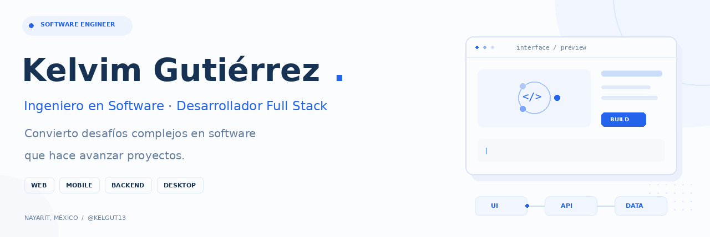
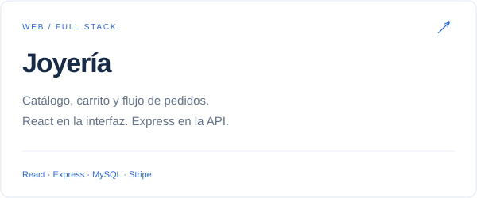
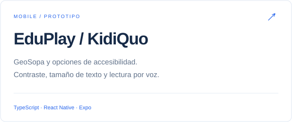

  React · TypeScript · Node.js 
  <a href="#proyectos-seleccionados">Proyectos</a> &nbsp; · &nbsp;
  <a href="mailto:kelvim19.gutierrez@gmail.com">Contacto</a>

### Desarrollo de principio a fin

Me interesa conectar el diseño de una interfaz con lo que ocurre detrás: navegación, estado, API, autenticación y persistencia. Trabajo con **React y TypeScript** en web, **React Native y Expo** en mobile, y **Node.js, Express y MySQL** en backend.

Desarrollo y mantengo el sitio institucional y el CMS de **FENINE**. También soy docente de robótica: enseño programación y electrónica mediante proyectos prácticos con LEGO.

### Proyectos seleccionados

<table>
  <tr>
    <td width="50%" valign="top">
      
      
Interfaz de catálogo, carrito, cuentas y pedidos conectada a una API propia.

      
<strong>En desarrollo.</strong> Incluye integración Stripe y simulación local; requiere revisión adicional antes de producción.

      <a href="https://github.com/KelGut13/Joyeria">Ver código y arquitectura →</a>
    </td>
    <td width="50%" valign="top">
      
      
Pantallas de acceso, registro y GeoSopa con contraste, tamaño de texto y lectura por voz.

      
<strong>Prototipo.</strong> Firebase gestiona cuentas y perfiles; parte del progreso es demostrativa.

      <a href="https://github.com/KelGut13/Hackton-Sep">Explorar la aplicación →</a>
    </td>
  </tr>
</table>

**[CRT Community API →](https://github.com/KelGut13/backend-crt)**  
Backend de cuentas, perfiles, amistades, conversaciones y logros. Node.js, Express, MySQL, JWT y recuperación de acceso con Resend. Incluye pruebas para evitar la exposición de códigos de recuperación. **En desarrollo.**

Los README individuales explican el alcance real, la instalación y las limitaciones de cada proyecto.

### Stack y áreas de trabajo

| Interfaces | Servicios y datos | Aplicaciones y entrega |
| :--- | :--- | :--- |
| React · TypeScript · JavaScript | Node.js · Express · APIs REST | React Native · Expo |
| HTML · CSS | MySQL · Firebase | Electron · SQLite |
| Navegación · estado · integración de APIs | Autenticación · persistencia | Git · GitHub · despliegues |

### Experiencia que conecta con el producto

- **FENINE · Desarrollo de software:** sitio institucional, CMS y mantenimiento desde abril de 2024.
- **Docencia en robótica:** programación, electrónica básica y proyectos prácticos desde agosto de 2023.
- **Freelance:** requerimientos, estimaciones, desarrollo, pruebas, documentación y soporte entre noviembre de 2021 y agosto de 2024.

El código propietario de **Genesis Systems** y los proyectos confidenciales se mantienen privados.

---

  <strong>Hablemos de tu próximo proyecto o equipo.</strong> 
  Interesado en oportunidades como Software Engineer / Full Stack Developer.  
  <a href="mailto:kelvim19.gutierrez@gmail.com">kelvim19.gutierrez@gmail.com</a> · <a href="https://github.com/KelGut13">@KelGut13</a>

